# 🍸 Awesome Cocktail & Recipe Management / Lifestyle Apps Ecosystem 🍹

  

  
  
  
  
  
  

---

## 🌟 Top Cocktail & Recipe Management / Lifestyle Apps Ecosystem

> **A definitive, SEO-optimized curated directory of production SaaS platforms, home bar inventory trackers, self-hosted mixology servers, Raspberry Pi automated drink dispensers, and open cocktail recipe databases.**

*Track, scale, filter, and craft cocktails with modern home-bar software, dynamic serving algorithms, and open-source stacks.*

📅 **Last updated: November 2026**

---

## 📑 Table of Contents

- [📊 Sector Overview & Market Dynamics](#-sector-overview--market-dynamics)
- [☁️ SaaS & Hosted Platforms](#️-saas--hosted-platforms)
- [💻 Open-Source GitHub Projects](#-open-source-github-projects)
- [🛠️ Architecture & System Frameworks](#️-architecture--system-frameworks)
- [🤝 How to Contribute](#-how-to-contribute)
- [💖 Support & Share](#-support--share)
- [📈 Star History](#-star-history)
- [⚖️ Disclaimer](#️-disclaimer)

---

## 📊 Sector Overview & Market Dynamics

The global digital recipe and culinary lifestyle applications market is estimated at approximately **$6B to $7B** (growing at **~8.5% to 10.5% CAGR**), with the connected smart home bar and digital mixology segment projected to exceed **$1.4B** over the next decade as home entertainment, smart home integration, and craft cocktail culture expand.

The cocktail software sector is **highly fragmented** rather than winner-take-all. Low technical barriers to entry and non-copyrightable public-domain classic recipes allow numerous independent indie developers, boutique design studios, and hospitality brands to co-exist. Competition centers primarily on curated craft flavor databases, UI/UX aesthetics, and intelligent home-bar inventory matching algorithms ("what can I make with my stocked bottles").

---

## ☁️ SaaS & Hosted Platforms

| Company / Product | Revenue / Valuation (Est. Size) | Pricing | Free Tier Limit | Description |
| :--- | :--- | :--- | :--- | :--- |
| **[Liquor.com](https://liquor.com)** | Parent (Dotdash Meredith / People Inc. under IAC): **~$1.78B annual revenue**; IAC market cap **~$3.2B** | Free ad-supported web portal / Editorial | Unlimited free access to all online recipe guides, bartending techniques, and reviews (monetized via programmatic ads and affiliate commerce) | Digital spirits, bartending, and cocktail publication providing editor-tested recipes, technique tutorials, and home bar equipment guides. |
| **[Highball](https://studioneat.com)** | Studio Neat (Developer): **~$6.3M annual revenue** (bootstrapped design studio) | Free download; optional in-app tips / physical barware store | 100% free with no recipe limits, no subscriptions, and full drink card generation/sharing capabilities | Design-forward iOS cocktail recipe organizer enabling users to create, collect, and share minimalist visual recipe cards via embeddable metadata. |
| **[Anvil Bar & Refuge](https://anvilhouston.com)** | Renowned craft bar hospitality group (Bobby Heugel / Thoroughfare): **~$2M–$4M annual revenue** | Web menu access is Free; bottled to-go cocktails start at **$35.00** | Unlimited free digital browsing of the iconic "List of 100 Classics" and seasonal menus; physical cocktails $13–$16+ | Iconic craft cocktail institution and inspiration behind modern classic cocktail lists and home-bar reference menus. |
| **[Cocktail Flow](https://cocktailflow.com)** | Distinction Kft. (Original dev): **~£1.1M (~$1.4M) historical turnover** | Starts at **$4.99 / month** (or discounted annual/multi-month packages) | Free base recipe library & inventory cabinet access; locked: 400+ premium cocktails, personal drink notes, and custom recipe creation | Cross-platform cocktail and mixed-drink app offering categorized bar stock management, shopping lists, seasonal collections, and step-by-step preparation guides. |
| **[Difford's Guide](https://diffordsguide.com)** | Odd Firm of Sin Ltd (Simon Difford): **~£500K–£1M annual turnover** (Independent private UK publisher) | Starts at **£3.50 / month** (billed annually at £42/year, or £5.00/mo billed monthly); includes 7-day free trial | Free Community Member plan with email registration: unlimited recipe reading and weekly newsletter; advanced multi-ingredient bottle filtering & ad-free UI require Premium | Comprehensive online cocktail encyclopedia and home-bar calculator matching thousands of curated classic and modern drink recipes against your stocked bottles. |
| **[Mixel](https://mixelcocktails.com)** | Independent niche mobile app developer: **~$200K–$500K estimated annual revenue** | Starts at **$2.99 / month** (or ~$11.99–$22.99 / year) | Free tier includes 100+ classic IBA recipes, full 600+ ingredient inventory tracker, and 5 AI chat queries/month; full 2,600+ recipes and cloud sync require Premium | Pixel-art mobile cocktail recipe manager featuring a massive curated recipe library, custom recipe builder, ingredient substitution suggestions, and shared bar sync. |
| **[Bartender's Choice](https://apple.com)** | Fancy Free LLC (Attaboy / Sam Ross): **~$100K–$300K estimated app sales** | **$9.99** one-time purchase on iOS / **$8.99** on Android | No free tier or trial; requires upfront purchase to download and access the 1,500+ curated recipes | Curated mobile cocktail app created by renowned New York craft bartenders featuring flavor-profile filtering, spirit selection, and bar-tested ratios. |
| **[Total Tiki](https://beachbumberry.com)** | Martin Doudoroff LLC / MixologyTech: **~$50K–$200K estimated annual revenue** | iOS App: **$9.99** one-time purchase; Web (Total Tiki Online): **$18.00 / quarter** (~$6/month) | Web tier includes a free demo mode to preview interface; clicking individual recipes requires subscription. iOS app has no free version (includes free iCloud device sync) | Specialized tiki and tropical cocktail database app featuring historical drink origins, garnish guides, and ingredient-inventory matching. |
| **[Cocktail Party App](https://cocktailpartyapp.com)** | Independent boutique app developer: **~$50K–$150K estimated annual revenue** | **$3.99** one-time purchase on iOS and Android | No free tier or free trial; upfront paid app with zero recurring subscriptions and lifetime recipe updates | Illustrated mobile and web cocktail guide focused on "make-with-what-you-have" home bar inventory filtering, step-by-step instructions, and zero ads. |
| **[Top Shelf Cocktail Lounge & Bar Apps](https://apple.com)** | Alexandru Budure / Independent indie dev: **<$50K estimated annual revenue** | Free download; **$4.99** one-time in-app purchase for full pack | Free tier provides access to the first 10 bars (110 drink levels) with no ads or time limits; remaining 6 bars require $4.99 unlock | Interactive mobile cocktail lounge and home bar catalog apps for tracking liquor cabinets, tasting notes, and party drink menus. |

---

## 💻 Open-Source GitHub Projects

*Ranked strictly in descending order by GitHub stargazers count. Star badges link directly to each repository's stargazers page.*

1. **[Mealie](https://github.com/mealie-recipes/mealie)**   
   Popular self-hosted recipe manager and meal/drink planner with one-click URL recipe scraping, automated ingredient parsing, shopping list generation, and Docker deployment.

2. **[Grocy](https://github.com/grocy/grocy)**   
   Full-featured self-hosted ERP for groceries, household pantries, and home bar cellars—tracks bottle stock, opened dates, expiration tracking, and cocktail ingredient consumption.

3. **[Tandoor Recipes](https://github.com/TandoorRecipes/recipes)**   
   Comprehensive Django/Vue self-hosted recipe and mixology management system featuring dynamic batch serving scaling, pantry inventory tracking, and multi-user recipe sharing.

4. **[KitchenOwl](https://github.com/TomBursch/kitchenowl)**   
   Modern, elegant self-hosted smart grocery list, pantry/bar inventory tracker, and recipe companion application with native clients for iOS, Android, and Web.

5. **[CookCLI / Cooklang](https://github.com/cooklang/cookcli)**   
   Open-source markup language and local web server for plain-text cocktail and culinary recipe management with automatic ingredient measurement scaling and shopping list generation.

6. **[Open Food Facts Server](https://github.com/openfoodfacts/openfoodfacts-server)**   
   Collaborative, free, and open database server powering barcode scanning and nutritional/ingredient metadata across commercial spirits, syrups, mixers, and beverages.

7. **[Bar Assistant](https://github.com/karlomikus/bar-assistant)**   
   Flagship self-hosted open-source cocktail and home-bar management API server featuring bottle shelf tracking, shopping lists, unit conversion, and multi-user bar collections.

8. **[Nextcloud Cookbook](https://github.com/nextcloud/cookbook)**   
   Nextcloud-integrated open-source recipe and drink organizer fully compatible with `schema.org/Recipe` JSON-LD standards and Nextcloud user syncing.

9. **[Open Drinks](https://github.com/alfg/opendrinks)**   
   Community-driven open-source cocktail and beverage catalog built with Markdown and Vue.js, featuring transparent recipe contributions, spirit filters, and custom drinks.

10. **[CocktailBerry](https://github.com/AndreWohnsland/CocktailBerry)**   
    Open-source Python and Qt/web dashboard application for Raspberry Pi automated cocktail dispenser machines and manual home bars with inventory monitoring and party stats.

11. **[CocktailPi](https://github.com/alex9849/CocktailPi)**   
    Self-hosted Java & Vue open-source cocktail maker and recipe management platform supporting peristaltic pump control, glass calibration, and real-time web UI order queuing.

12. **[Vue Salt Rim](https://github.com/karlomikus/vue-salt-rim)**   
    Modern open-source Vue.js web frontend interface for Bar Assistant, providing instant "what drinks can I make with my bottles" filtering, printable recipes, and mobile bar browsing.

13. **[Cocktails (balevine)](https://github.com/balevine/cocktails)**   
    Curated open-source personal collection of craft cocktail recipes formatted in clean JSON with serving glass types, proportions, and preparation instructions.

14. **[IBA Cocktails Dataset (teijo)](https://github.com/teijo/iba-cocktails)**   
    Clean, structured open-source JSON dataset of official International Bartenders Association (IBA) cocktail recipes, ingredient quantities, preparation glassware, and garnishes.

15. **[RecipeMD](https://github.com/RecipeMD/RecipeMD)**   
    Lightweight open-source human-readable Markdown specification and CLI/web parser for storing portable, Git-versioned cocktail and culinary recipes in plain text files.

16. **[Cocktail Search (snoack)](https://github.com/snoack/cocktail-search)**   
    Faceted cocktail recipe search engine built with Python, Werkzeug, Scrapy, and Sphinx, matching ingredients against historical cocktail databases.

17. **[Mojito](https://github.com/hvsimon/Mojito)**   
    Open-source Android mobile cocktail manual and mixology reference guide featuring curated recipes, drink photography, spirit profiles, and search filters.

18. **[IBA Cocktails (rasmusab)](https://github.com/rasmusab/iba-cocktails)**   
    Parsed CSV and JSON dataset of official IBA cocktail recipes suitable for data science, algorithmic recipe matching, and mixology visualizations.

19. **[NYT Bar Optimizer](https://github.com/jordanmeyer/nyt-bar-optimizer)**   
    Mathematical bottle optimizer that evaluates your home bar inventory against New York Times Cooking cocktail recipes to recommend which bottles unlock the most drinks.

20. **[Libations](https://github.com/jnsgruk/libations)**   
    Self-hosted, mobile-first cocktail recipe store and bar cabinet catalog built with modern web technologies for offline access on smartphones and tablets.

---

## 🛠️ Architecture & System Frameworks

* **Dedicated Self-Hosted Home Bar Stack**: Deploy **Bar Assistant** (backend API) alongside **Salt Rim** (Vue.js frontend) via Docker Compose for dedicated bottle tracking and recipe matching.
* **Unified Culinary & Mixology Managers**: Run **Mealie** or **Tandoor Recipes** to manage both cooking recipes and craft cocktails in a single multi-user web app.
* **Plain-Text Git-Versioned Books**: Standardize recipes using **Cooklang (`cookcli`)** or **RecipeMD** for Git-trackable, offline-first cocktail guides.
* **Hardware Automation & IoT Dispensers**: Run **CocktailBerry** or **CocktailPi** on a Raspberry Pi connected to relay boards and peristaltic pumps for automated party drink pouring.
* **Developer Datasets & Free APIs**: Leverage **TheCocktailDB** or **IBA Cocktails JSON** to power custom Flutter, React Native, or web mixology projects.

---

## 🤝 How to Contribute

Contributions are warmly welcomed! Help expand this ecosystem:

1. 🍴 **Fork the repository**.
2. 🌿 Create a feature branch: `git checkout -b feature/new-cocktail-platform`.
3. 📝 Add your tool following the existing table or star-ranked list format.
4. 🔍 Ensure descriptions are objective and link to official documentation or source code.
5. 🚀 Submit a Pull Request with a brief summary of the project.

---

## 💖 Support & Share

Thank you for exploring this curated cocktail and lifestyle software directory! If you find this guide valuable for your home bar, culinary adventures, or mixology development, here is how you can support the ecosystem:

- ⭐ **Star this repository** to improve discoverability across GitHub.
- 🍴 **Fork and share** the project with home bartenders, mixologists, and self-hosting groups on Discord, Reddit, and X/Twitter.
- ☕ **Buy me a coffee & Sponsor my open-source work**: Support continuous maintenance and new open-source curated tools on the [GitHub Sponsor Dashboard](https://github.com/sponsors/ishandutta2007).

  

---

## 📈 Star History

---

## ⚖️ Disclaimer

- This repository is a **community-curated index** provided for informational and educational purposes only.
- Cocktail, wine, and spirits applications are intended strictly for adults of legal drinking age in their respective regions. Please enjoy responsibly.
- Self-hosted servers exposed to the public internet should implement strong authentication, reverse proxies, and TLS/HTTPS encryption.

---

  <b>Made with 🍸 and ❤️ for home bartenders, mixology enthusiasts, culinary creators, and open-source contributors worldwide.</b>

